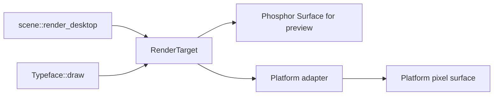

# Phosphor Rendering Architecture

## Purpose and current scope

Phosphor is a small Rust rendering library for a custom desktop design. The
current scene is a static composition based on `Bureau et lanceur@2x.png`: a
teal wallpaper, desktop shortcuts, a file manager, an assistant panel, an app
launcher, and a bottom bar.

The library paints pixels and text. It does not currently own a display,
window manager, input loop, application lifecycle, or Redox driver. The host
preview and the PrismOS integration provide different render targets to the
same drawing code.

## Crate layout

| File | Responsibility |
| --- | --- |
| `src/lib.rs` | `Color`, the owned RGBA `Surface`, and software drawing primitives. |
| `src/target.rs` | `RenderTarget`, the interface implemented by a drawing destination. |
| `src/scene.rs` | Normalized, static desktop layout and its pictograms. |
| `src/text.rs` | TrueType loading and glyph rasterization using `fontdue`. |
| `examples/preview.rs` | `std`-based host tool that writes a PPM preview. |

The library is `no_std` and uses `alloc`. A host or kernel integrating it must
provide an allocator before allocating a `Surface` or parsing a font. The
preview example uses the host standard library and allocator; neither is part
of the library's runtime.

## Render flow



`scene::render_desktop` receives a mutable render target and a loaded
`Typeface`. The scene expresses its layout as fractions of the target width
and height, then calls the target's rectangle, rounded rectangle, ellipse,
line, gradient, pixel, and text operations. This lets the same layout scale to
different screen sizes without making the scene aware of a framebuffer's
stride or pixel format.

### `Color` and `Surface`

`Color` stores red, green, blue, and alpha bytes. `Color::rgb` creates an
opaque color; `Color::rgba` keeps the supplied alpha for blending. Phosphor's
owned `Surface` stores a row-major `Vec<Color>` and clips drawing to its
width and height. Its `blend_pixel`, rectangle and rounded-rectangle
operations composite source color over the existing pixel. The desktop scene
begins with an opaque vertical wallpaper gradient.

This owned surface is convenient for previews and simple hosts. A kernel that
already owns its framebuffer can avoid a second full-screen RGBA allocation by
implementing `RenderTarget` for a wrapper around its own surface.

### `RenderTarget` contract

An implementation provides target dimensions, alpha-blended pixel writes,
rectangle fills, and rounded rectangle fills. The trait supplies default
helpers for clearing, a vertical gradient, ellipses, and integer lines. Pixel
coordinates outside the target must be ignored, and alpha must be applied
consistently by every primitive.

Colors passed to the trait are straight (not premultiplied) RGBA. The target
chooses how RGB bytes map to its native storage. The scene does not assume a
channel order, stride, display server, or hardware device.

### Text

`Typeface::from_bytes` parses TrueType font data with `fontdue`. `draw` places a
single-line string at its top-left coordinate and sends coverage pixels to a
`RenderTarget` using alpha blending. The renderer clips through the target's
pixel method. Phosphor currently rasterizes glyphs while drawing rather than
maintaining a glyph cache, so platform integrations should treat scene
construction as a one-time operation until caching is added.

## Host preview

Run from the repository root:

```sh
cargo run --example preview -- /tmp/phosphor-preview.ppm
```

The example loads DejaVu Sans from common host font paths. A font path can be
passed as the second argument. It creates a 1280 by 720 owned `Surface`, draws
the static scene, and writes its RGB channels as a binary PPM image. The
preview verifies the host renderer; it does not verify a kernel or display
backend.

## Current limitations

- The desktop is a static mockup; buttons, windows, and shortcuts are not
  interactive yet.
- Phosphor does not create or own a Redox display connection. A Redox backend
  still needs a supported path to present pixels and receive input.
- The PrismOS adapter is a kernel-side integration prototype. See
  [`prism-os-integration.md`](prism-os-integration.md) for its data flow and
  current verification status.
- Text shaping, glyph caching, damage tracking, and multiple-window surfaces
  are not implemented in Phosphor.
