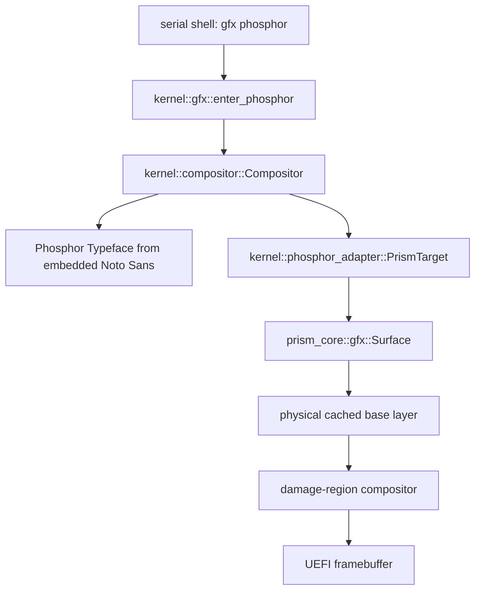

# Phosphor in PrismOS

## Goal

PrismOS already has a kernel-owned framebuffer surface and compositor.
Phosphor's desktop scene can therefore be tried without adding a second
display stack: Prism provides a `RenderTarget` adapter that converts
Phosphor drawing calls to the existing `prism_core::gfx::Surface` API.

This is a static kernel-rendered preview. It does not make Phosphor a Redox
backend, create a userspace display server, or provide interactive Phosphor
windows and controls.

## Data flow



## How the connection works

1. The shell parser recognizes `gfx phosphor` as `GfxAction::Phosphor`.
2. The handler calls `gfx::enter_phosphor`, which selects the Phosphor design
   while keeping the existing screen-ownership path.
3. `Compositor::new` allocates Prism's physical back buffer and cached base
   layer. It parses the bundled `prism-core/assets/fonts/NotoSans-Regular.ttf`
   through Phosphor's `Typeface` API.
4. `phosphor_adapter::PrismTarget` implements Phosphor's `RenderTarget` for a
   borrowed `prism_core::gfx::Surface`. It maps RGBA colors to Prism's
   `0x00RRGGBB` values, passes alpha to Prism's blend operations, and delegates
   clipping and RGB/BGR channel order to Prism's surface implementation.
5. Phosphor paints once into the cached base layer. Later damage regions copy
   from this base into the back buffer. Prism's window chrome, status bar and
   taskbar are skipped in this mode; Prism still draws its pointer last.
6. `gfx off` releases the compositor surfaces and restores the text console.
   `gfx on` continues to select the original PrismOS desktop.

The adapter lives in the PrismOS kernel because Rust's orphan rules prevent
implementing Phosphor's trait directly for the external Prism surface type.
Phosphor itself has no dependency on PrismOS.

## Try it

The PrismOS manifest currently uses a local dependency at `../../phosphor`, so
the checkout layout is expected to be:

```text
tree/
├── phosphor/
└── prism-os/
```

Build and boot PrismOS using its normal UEFI instructions. At the serial shell,
run:

```text
gfx phosphor
```

Return to text mode with `gfx off`. Use `gfx on` for the PrismOS desktop.
Switching designs requires leaving graphics mode first.

## Design boundaries and current status

- Prism owns framebuffer access, physical surface allocation, clipping,
  presentation, pointer input, and screen ownership.
- Phosphor owns the static visual layout and text/shape drawing calls.
- Prism's Noto Sans font is used for the kernel preview; the standalone host
  preview normally uses DejaVu Sans, so text metrics and appearance can differ.
- This mode does not implement Phosphor interaction or refresh a live clock in
  its static image.
- The dependency is currently a local path, not a published or vendored crate.
- The integration has passed a host-side kernel `cargo check`. A QEMU pixel
  proof for `gfx phosphor` is still pending; the standard `proof_gfx.py` covers
  the original PrismOS design.

For the underlying PrismOS compositor and graphics invariants, see
[`prism-os-graphics`](../../prism-os/docs/graphics-design.md) in the sibling
checkout.
